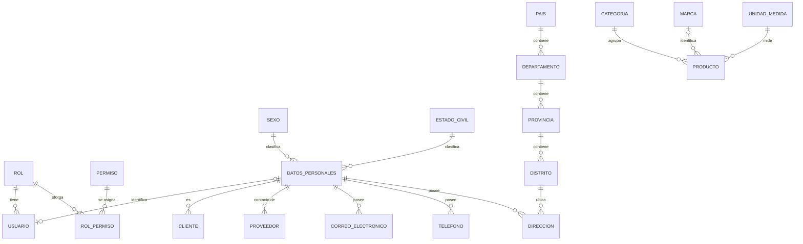

# 13.2. Módulos básicos — Esquema canónico, formas normales, clases y patrones (Gestiona Commerce)

> Versión depurada del Excel original. **Este archivo manda** sobre cualquier otro esquema.
> Alcance: módulos 1 a 6 (hasta Etapa 5). Los módulos 7 (Ventas) y 8 (Reportes) están **fuera del Avance 1**.
> Relacionados: [[Etapas]] · `AGENTS.md`

---

## 0. Decisiones de diseño (resuelven las contradicciones del Excel)

| # | Decisión | Motivo |
| --- | --- | --- |
| D1 | Un usuario tiene **un solo rol** (`usuario.id_rol`). Los permisos se asignan al rol mediante la tabla **`rol_permiso`** (M:N). Se descartan `usuario.permiso_id` y `Usuario_Rol`. | RBAC estándar; evita que cada usuario cargue un permiso suelto. |
| D2 | **`datos_personales` es la entidad "persona" compartida** por `usuario`, `cliente` y `proveedor` (`usuario.id_datos_personales`, `cliente.id_datos_personales`, `proveedor.id_datos_personales`). | Evita duplicar nombres, DNI, correos, teléfonos y direcciones. |
| D3 | La tabla se crea por etapas: `usuario` nace en la Etapa 3 **sin** `id_datos_personales`; en la Etapa 4 se agrega con `ALTER TABLE`. | Cada etapa deja evidencia propia. |
| D4 | **Base de datos: Supabase = PostgreSQL.** Nombres en `snake_case` minúscula. Equivalencias con el Excel: `idUsuario` → `id_usuario`, `contraseña` → `contrasena_hash`, `BIT` → `BOOLEAN`, `DATETIME` → `TIMESTAMP`, `INT (PK)` → `INT GENERATED ALWAYS AS IDENTITY`. | PostgreSQL pliega a minúsculas los identificadores sin comillas; evita comillas en todo el código. |
| D5 | Historial de logins, recuperación de contraseña por token y auditoría detallada **no** se implementan en este avance (solo existe la columna `token_recuperacion`). | Fuera de las etapas 1-5. |

### Columnas de auditoría `+AUD` (se agregan a toda tabla marcada con +AUD)
| Columna | Tipo | Descripción |
| --- | --- | --- |
| fecha_creacion | TIMESTAMP DEFAULT now() | Fecha en que se registró |
| fecha_actualizacion | TIMESTAMP | Fecha de la última modificación |
| usuario_registro | VARCHAR(50) | Usuario que registró el dato |
| estado | VARCHAR(15) DEFAULT 'Activo' | Activo / Inactivo (la eliminación del CRUD es **lógica**: pasa a Inactivo) |

---

## 1. Módulos del sistema (alcance)

| Nº | Módulo | Condición | Descripción |
| --- | --- | --- | --- |
| 1.0 | Acceso al sistema (Login) | Requerido | Autenticación; a los 3 intentos erróneos el usuario se bloquea. |
| 2.0 | Menú principal | Requerido | Acceso centralizado a los módulos según el rol. |
| 3.0 | Gestión de usuarios | Requerido | CRUD de cuentas, roles y datos personales. |
| 4.0 | Gestión de clientes | Depende del proyecto | CRUD de clientes. |
| 5.0 | Gestión de proveedores | Depende del proyecto | CRUD de proveedores. |
| 6.0 | Gestión de mercadería/productos/insumos/servicios | Depende del proyecto | CRUD de productos, stock y precios. |
| 7.0 / 8.0 | Ventas / Reportes | — | **Fuera del Avance 1.** |

---

## 2. Esquema canónico por etapa

### Etapa 2 (tabla provisional, se reemplaza en la Etapa 3)
| Tabla | Campos |
| --- | --- |
| usuarios | id_usuario INT PK · nombre_usuario VARCHAR(50) · contrasena VARCHAR(255) *(sin cifrar solo en esta etapa)* |

### Etapa 3 — Acceso y seguridad
| Tabla | Campo | Tipo | Descripción |
| --- | --- | --- | --- |
| **rol** | id_rol | INT PK | Identificador del rol |
| | nombre_rol | VARCHAR(30) UNIQUE NOT NULL | Administrador, Vendedor… |
| | descripcion | VARCHAR(100) | Descripción del rol |
| | +AUD | | |
| **permiso** | id_permiso | INT PK | Identificador del permiso |
| | nombre_permiso | VARCHAR(50) UNIQUE NOT NULL | Ej. GESTIONAR_USUARIOS |
| | descripcion | VARCHAR(150) | Qué permite hacer |
| | +AUD | | |
| **rol_permiso** | id_rol | INT FK → rol | PK compuesta |
| | id_permiso | INT FK → permiso | PK compuesta |
| | fecha_creacion | TIMESTAMP DEFAULT now() | |
| **usuario** | id_usuario | INT PK | Identificador del usuario |
| | nombre_usuario | VARCHAR(50) UNIQUE NOT NULL | Usuario para iniciar sesión |
| | contrasena_hash | VARCHAR(255) NOT NULL | Hash BCrypt (nunca texto plano) |
| | id_rol | INT FK → rol NOT NULL | Rol asignado |
| | ultimo_acceso | TIMESTAMP | Último login exitoso |
| | intentos_fallidos | INT DEFAULT 0 | Contador de intentos erróneos |
| | bloqueado | BOOLEAN DEFAULT false | true al llegar a 3 intentos |
| | token_recuperacion | VARCHAR(255) NULL | Reservado (no se usa aún) |
| | +AUD | | |

### Etapa 4 — Datos personales, contacto y ubicación
| Tabla | Campo | Tipo | Descripción |
| --- | --- | --- | --- |
| **sexo** | id_sexo | INT PK | |
| | descripcion | VARCHAR(20) | Masculino, Femenino, No binario, Prefiere no decirlo |
| | +AUD | | |
| **estado_civil** | id_estado_civil | INT PK | |
| | descripcion | VARCHAR(20) | Soltero, Casado, Divorciado, Viudo, Conviviente |
| | +AUD | | |
| **pais** | id_pais | INT PK | |
| | nombre_pais | VARCHAR(100) | |
| | +AUD | | |
| **departamento** | id_departamento | INT PK | |
| | nombre_departamento | VARCHAR(100) | |
| | id_pais | INT FK → pais | |
| | +AUD | | |
| **provincia** | id_provincia | INT PK | |
| | nombre_provincia | VARCHAR(100) | |
| | id_departamento | INT FK → departamento | |
| | +AUD | | |
| **distrito** | id_distrito | INT PK | |
| | nombre_distrito | VARCHAR(100) | |
| | id_provincia | INT FK → provincia | |
| | +AUD | | |
| **datos_personales** | id_datos_personales | INT PK | Persona compartida (usuario/cliente/proveedor) |
| | nombres | VARCHAR(80) NOT NULL | |
| | apellidos | VARCHAR(80) NOT NULL | |
| | dni | VARCHAR(15) UNIQUE | |
| | fecha_nacimiento | DATE | |
| | id_sexo | INT FK → sexo | |
| | id_estado_civil | INT FK → estado_civil | |
| | +AUD | | |
| **correo_electronico** | id_correo | INT PK | |
| | id_datos_personales | INT FK | |
| | correo | VARCHAR(80) | |
| | tipo_correo | VARCHAR(20) | personal, laboral, institucional |
| | +AUD | | |
| **telefono** | id_telefono | INT PK | |
| | id_datos_personales | INT FK | |
| | numero_telefono | VARCHAR(20) | |
| | tipo_telefono | VARCHAR(20) | móvil, fijo, oficina |
| | +AUD | | |
| **direccion** | id_direccion | INT PK | |
| | id_datos_personales | INT FK | |
| | id_distrito | INT FK → distrito | |
| | calle_avenida | VARCHAR(150) | |
| | numero | VARCHAR(10) | |
| | piso | VARCHAR(10) | |
| | tipo_direccion | VARCHAR(20) | domicilio, trabajo, fiscal |
| | referencia | VARCHAR(255) | |
| | +AUD | | |
| **usuario** *(ALTER)* | id_datos_personales | INT FK UNIQUE NULL | Se agrega en esta etapa |

### Etapa 5 — Clientes, proveedores y mercadería
| Tabla | Campo | Tipo | Descripción |
| --- | --- | --- | --- |
| **categoria** | id_categoria | INT PK | |
| | nombre_categoria | VARCHAR(60) UNIQUE | |
| | descripcion | VARCHAR(150) | |
| | +AUD | | |
| **marca** | id_marca | INT PK | |
| | nombre_marca | VARCHAR(60) UNIQUE | |
| | +AUD | | |
| **unidad_medida** | id_unidad_medida | INT PK | |
| | nombre | VARCHAR(30) | Unidad, Kilogramo… |
| | abreviatura | VARCHAR(10) | UND, KG… |
| | +AUD | | |
| **cliente** | id_cliente | INT PK | |
| | id_datos_personales | INT FK | Persona o contacto |
| | tipo_cliente | VARCHAR(20) | Natural / Empresa |
| | ruc | VARCHAR(11) NULL | Solo empresas |
| | razon_social | VARCHAR(120) NULL | Solo empresas |
| | +AUD | | |
| **proveedor** | id_proveedor | INT PK | |
| | id_datos_personales | INT FK | Persona de contacto |
| | ruc | VARCHAR(11) UNIQUE NOT NULL | |
| | razon_social | VARCHAR(120) NOT NULL | |
| | +AUD | | |
| **producto** | id_producto | INT PK | |
| | codigo | VARCHAR(20) UNIQUE | Código interno |
| | nombre | VARCHAR(100) NOT NULL | |
| | descripcion | VARCHAR(255) | |
| | tipo | VARCHAR(15) CHECK | MERCADERIA, PRODUCTO, INSUMO, SERVICIO |
| | id_categoria | INT FK → categoria | |
| | id_marca | INT FK → marca NULL | Nulo en servicios |
| | id_unidad_medida | INT FK → unidad_medida | |
| | precio_compra | NUMERIC(10,2) | |
| | precio_venta | NUMERIC(10,2) | |
| | stock_actual | INT DEFAULT 0 | 0 en servicios |
| | stock_minimo | INT DEFAULT 0 | |
| | +AUD | | |

---

## 3. Diagrama entidad-relación (3FN) — se renderiza en Obsidian



---

## 4. Evaluación de formas normales

| Tablas | Forma normal | Estado | Justificación |
| --- | --- | --- | --- |
| rol, permiso, rol_permiso, usuario | 1FN, 2FN, 3FN | Cumple | Rol y permiso son catálogos independientes; `rol_permiso` resuelve la relación M:N con clave compuesta; la descripción del rol no se repite por usuario (sin dependencia transitiva). |
| datos_personales, sexo, estado_civil | 1FN, 2FN, 3FN | Cumple | Sexo y estado civil son catálogos referenciados por FK; atributos atómicos. |
| correo_electronico, telefono, direccion | 1FN (y 4FN) | Cumple | Eliminan grupos repetitivos (nada de Tel1/Tel2) y separan dependencias multivaluadas independientes de la persona. |
| distrito, provincia, departamento, pais | 3FN | Cumple | La jerarquía territorial elimina dependencias transitivas: el país no depende de la dirección sino de su propia clave. |
| categoria, marca, unidad_medida, producto | 1FN, 2FN, 3FN | Cumple | Catálogos independientes; `producto` solo guarda FKs a ellos. |
| cliente, proveedor | 3FN | Cumple | Identidad y datos comunes viven en `datos_personales`; solo se guardan los atributos propios (RUC, razón social). |

---

## 5. Datos de ejemplo corregidos (ficticios, jerarquía geográfica válida)

> Las contraseñas **no** se guardan aquí en el esquema: el agente debe generar los hashes BCrypt con un `SeedUsuarios` (clase utilitaria) a partir de la tabla de credenciales de prueba. En la Etapa 2 se usa la contraseña simple; en la Etapa 3 se migra a hash.

### rol
| id_rol | nombre_rol | descripcion |
| --- | --- | --- |
| 1 | Administrador | Acceso total al sistema |
| 2 | Vendedor | Gestiona clientes y consulta productos |
| 3 | Almacenero | Gestiona productos y consulta proveedores |
| 4 | Supervisor | Supervisa clientes, proveedores y productos (solo lectura) |
| 5 | Invitado | Solo consulta de productos |

### permiso
| id_permiso | nombre_permiso | descripcion |
| --- | --- | --- |
| 1 | VER_DASHBOARD | Acceder al panel principal |
| 2 | GESTIONAR_USUARIOS | CRUD de usuarios |
| 3 | GESTIONAR_CLIENTES | CRUD de clientes |
| 4 | VER_CLIENTES | Consultar clientes |
| 5 | GESTIONAR_PROVEEDORES | CRUD de proveedores |
| 6 | VER_PROVEEDORES | Consultar proveedores |
| 7 | GESTIONAR_PRODUCTOS | CRUD de productos/servicios |
| 8 | VER_PRODUCTOS | Consultar productos/servicios |
| 9 | ASIGNAR_PERMISOS | Otorgar o revocar permisos a roles |

### rol_permiso (✔ = asignado)
| Rol \ Permiso | 1 | 2 | 3 | 4 | 5 | 6 | 7 | 8 | 9 |
| --- | --- | --- | --- | --- | --- | --- | --- | --- | --- |
| Administrador | ✔ | ✔ | ✔ | ✔ | ✔ | ✔ | ✔ | ✔ | ✔ |
| Vendedor | ✔ | | ✔ | ✔ | | | | ✔ | |
| Almacenero | ✔ | | | | | ✔ | ✔ | ✔ | |
| Supervisor | ✔ | | | ✔ | | ✔ | | ✔ | |
| Invitado | ✔ | | | | | | | ✔ | |

### usuario + credenciales de prueba (solo para desarrollo)
| id_usuario | nombre_usuario | id_rol | contraseña de prueba | intentos_fallidos | bloqueado | persona (Etapa 4) |
| --- | --- | --- | --- | --- | --- | --- |
| 1 | lfernandez | 1 | `Admin#2026` | 0 | false | DP01 |
| 2 | mtorres | 2 | `Ventas#2026` | 0 | false | DP02 |
| 3 | cgomez | 3 | `Almacen#2026` | 0 | false | DP03 |
| 4 | jaguilar | 4 | `Super#2026` | 0 | false | DP04 |
| 5 | rlopez | 5 | `Invitado#2026` | 0 | false | DP05 |
| 6 | amendoza | 2 | `Bloqueo#2026` | 3 | **true** | DP06 (usuario ya bloqueado para probar la validación) |

### sexo
| id_sexo | descripcion |
| --- | --- |
| 1 | Masculino |
| 2 | Femenino |
| 3 | No binario |
| 4 | Prefiere no decirlo |

### estado_civil
| id_estado_civil | descripcion |
| --- | --- |
| 1 | Soltero |
| 2 | Casado |
| 3 | Divorciado |
| 4 | Viudo |
| 5 | Conviviente |

### pais
| id_pais | nombre_pais |
| --- | --- |
| 1 | Perú |
| 2 | Chile |
| 3 | Ecuador |
| 4 | Colombia |
| 5 | Argentina |
| 6 | Bolivia |

### departamento (todos de Perú)
| id_departamento | nombre_departamento | id_pais |
| --- | --- | --- |
| 1 | Lima | 1 |
| 2 | Cusco | 1 |
| 3 | Arequipa | 1 |
| 4 | Piura | 1 |
| 5 | Callao | 1 |

### provincia
| id_provincia | nombre_provincia | id_departamento |
| --- | --- | --- |
| 1 | Lima | 1 |
| 2 | Cusco | 2 |
| 3 | Urubamba | 2 |
| 4 | Arequipa | 3 |
| 5 | Camaná | 3 |
| 6 | Piura | 4 |
| 7 | Paita | 4 |
| 8 | Callao | 5 |

### distrito
| id_distrito | nombre_distrito | id_provincia |
| --- | --- | --- |
| 1 | Miraflores | 1 |
| 2 | San Isidro | 1 |
| 3 | Santiago de Surco | 1 |
| 4 | Jesús María | 1 |
| 5 | Cusco | 2 |
| 6 | San Blas | 2 |
| 7 | Urubamba | 3 |
| 8 | Ollantaytambo | 3 |
| 9 | Yanahuara | 4 |
| 10 | Cayma | 4 |
| 11 | Camaná | 5 |
| 12 | Piura | 6 |
| 13 | Castilla | 6 |
| 14 | Paita | 7 |
| 15 | Bellavista | 8 |
| 16 | La Perla | 8 |

### datos_personales (usuarios DP01–DP06, clientes DP07–DP10, contactos de proveedores DP11–DP13)
| id | nombres | apellidos | dni | fecha_nacimiento | id_sexo | id_estado_civil |
| --- | --- | --- | --- | --- | --- | --- |
| 1 | Luis | Fernández Paredes | 45896321 | 1990-05-21 | 1 | 2 |
| 2 | María | Torres Vargas | 48963214 | 1989-08-11 | 2 | 2 |
| 3 | Carla | Gómez Rivas | 50987452 | 1995-01-09 | 2 | 1 |
| 4 | José | Aguilar Ramos | 47256314 | 1987-12-15 | 1 | 2 |
| 5 | Ricardo | López Medina | 45789632 | 1992-04-18 | 1 | 1 |
| 6 | Andrea | Mendoza Castillo | 51896325 | 1996-02-25 | 2 | 1 |
| 7 | Sofía | Ramírez León | 50897415 | 1997-06-22 | 2 | 1 |
| 8 | Diego | Rojas Gutiérrez | 47859632 | 1991-09-12 | 1 | 3 |
| 9 | Camila | Vargas Soto | 52478963 | 1998-11-28 | 2 | 1 |
| 10 | Felipe | Castro Arias | 46321587 | 1994-10-05 | 1 | 2 |
| 11 | Arturo | Silva Díaz | 49563124 | 1985-03-03 | 1 | 2 |
| 12 | Natalia | Espinoza Campos | 52987415 | 1999-01-30 | 2 | 1 |
| 13 | Hugo | Pacheco Salazar | 46987123 | 1992-08-14 | 1 | 5 |

*(El id real es el número; DP01…DP13 son solo alias de lectura.)*

### correo_electronico / telefono / direccion (uno por persona; id_datos_personales 1–13)
| id_datos_personales | correo | tipo_correo | numero_telefono | tipo_telefono | calle_avenida | numero | id_distrito | tipo_direccion |
| --- | --- | --- | --- | --- | --- | --- | --- | --- |
| 1 | lfernandez@gmail.com | personal | 999456123 | móvil | Av. Larco | 345 | 1 | domicilio |
| 2 | mariatorres@gmail.com | personal | 987654321 | móvil | Calle Los Sauces | 112 | 2 | domicilio |
| 3 | carlagomez@hotmail.com | personal | 951357456 | móvil | Jr. San Blas | 51 | 6 | domicilio |
| 4 | jaguilar@yahoo.com | personal | 942753951 | móvil | Av. Ejército | 200 | 9 | domicilio |
| 5 | rlopez@gmail.com | personal | 934256789 | móvil | Av. Guardia Chalaca | 765 | 15 | domicilio |
| 6 | andrea.mendoza@hotmail.com | personal | 945123687 | móvil | Calle Los Pinos | 234 | 3 | domicilio |
| 7 | sofia.ramirez@gmail.com | personal | 941236587 | móvil | Av. Universitaria | 1789 | 16 | domicilio |
| 8 | diego.rojas@outlook.com | laboral | 999874512 | móvil | Av. Angamos Oeste | 950 | 4 | fiscal |
| 9 | camila.vargas@gmail.com | personal | 956874123 | móvil | Jr. Amazonas | 412 | 12 | domicilio |
| 10 | felipe.castro@hotmail.com | personal | 953214879 | móvil | Av. Prolongación Grau | 540 | 13 | domicilio |
| 11 | arturo.silva@silvaherramientas.pe | laboral | 972458963 | móvil | Av. Argentina | 2100 | 15 | fiscal |
| 12 | natalia.espinoza@espinoza.pe | laboral | 987412365 | móvil | Jr. Huallaga | 675 | 5 | fiscal |
| 13 | hugo.pacheco@pinturassur.pe | laboral | 987654987 | móvil | Av. Los Incas | 890 | 10 | fiscal |

### usuario ← datos personales (UPDATE de la Etapa 4)
`usuario.id_datos_personales`: 1→1, 2→2, 3→3, 4→4, 5→5, 6→6.

### categoria
| id_categoria | nombre_categoria |
| --- | --- |
| 1 | Herramientas manuales |
| 2 | Herramientas eléctricas |
| 3 | Pinturas |
| 4 | Tornillería y fijación |
| 5 | Materiales de construcción |
| 6 | Gasfitería |
| 7 | Servicios |

### marca
| id_marca | nombre_marca |
| --- | --- |
| 1 | Stanley |
| 2 | Bosch |
| 3 | Truper |
| 4 | Pavco |
| 5 | Genérica |

### unidad_medida
| id_unidad_medida | nombre | abreviatura |
| --- | --- | --- |
| 1 | Unidad | UND |
| 2 | Kilogramo | KG |
| 3 | Metro | M |
| 4 | Galón | GL |
| 5 | Caja | CJ |
| 6 | Servicio | SRV |

### cliente
| id_cliente | id_datos_personales | tipo_cliente | ruc | razon_social |
| --- | --- | --- | --- | --- |
| 1 | 7 | Natural | | |
| 2 | 8 | Empresa | 20512345678 | Constructora Rojas SAC |
| 3 | 9 | Natural | | |
| 4 | 10 | Natural | | |

### proveedor
| id_proveedor | id_datos_personales | ruc | razon_social |
| --- | --- | --- | --- |
| 1 | 11 | 20601234567 | Aceros y Herramientas Silva SAC |
| 2 | 12 | 20456789123 | Distribuidora Espinoza EIRL |
| 3 | 13 | 20387654321 | Pinturas del Sur SAC |

### producto
| id | codigo | nombre | tipo | cat | marca | unidad | precio_compra | precio_venta | stock | stock_min |
| --- | --- | --- | --- | --- | --- | --- | --- | --- | --- | --- |
| 1 | HM-001 | Martillo de uña 16 oz | MERCADERIA | 1 | 1 | 1 | 18.00 | 29.90 | 40 | 10 |
| 2 | HM-002 | Destornillador Phillips #2 | MERCADERIA | 1 | 3 | 1 | 4.50 | 9.90 | 120 | 30 |
| 3 | HE-001 | Taladro percutor 650 W | MERCADERIA | 2 | 2 | 1 | 165.00 | 239.00 | 12 | 3 |
| 4 | HE-002 | Amoladora angular 4 1/2" | MERCADERIA | 2 | 2 | 1 | 140.00 | 205.00 | 8 | 3 |
| 5 | PI-001 | Pintura látex blanca | MERCADERIA | 3 | 5 | 4 | 38.00 | 59.90 | 30 | 8 |
| 6 | TO-001 | Tornillo autorroscante 1" (x100) | MERCADERIA | 4 | 5 | 5 | 6.00 | 11.50 | 200 | 50 |
| 7 | MC-001 | Cemento 42.5 kg | INSUMO | 5 | 5 | 1 | 24.00 | 31.50 | 150 | 40 |
| 8 | GA-001 | Tubo PVC 1/2" x 5 m | MERCADERIA | 6 | 4 | 1 | 7.50 | 13.90 | 60 | 15 |
| 9 | SV-001 | Servicio de corte a medida | SERVICIO | 7 | | 6 | 0.00 | 15.00 | 0 | 0 |
| 10 | SV-002 | Servicio de delivery local | SERVICIO | 7 | | 6 | 0.00 | 10.00 | 0 | 0 |

---

## 6. Clases POO (módulos 1–6)

| Módulo | Clase | Descripción | Atributos principales | Métodos principales |
| --- | --- | --- | --- | --- |
| 1 Acceso | Usuario | Persona que accede al sistema | idUsuario, nombreUsuario, contrasenaHash, rol, estado, intentosFallidos, bloqueado | validarCredenciales(), bloquearCuenta(), restablecerIntentos() |
| 1 Acceso | Sesion | Sesión activa | idSesion, fechaInicio, usuarioActivo | abrirSesion(), cerrarSesion(), verificarSesion() |
| 2 Menú | Menu | Opciones según rol | nombreOpcion, listaOpciones, rolPermitido | mostrarMenu(), filtrarOpcionesPorRol() |
| 3 Usuarios | Usuario (reutilizada) + Rol, Permiso, DatosPersonales | CRUD de cuentas | idUsuario, nombreUsuario, rol, datosPersonales | crear(), actualizar(), eliminar(), listar() |
| 4 Clientes | Cliente | Cliente registrado | idCliente, datosPersonales, tipoCliente, ruc, razonSocial | registrar(), actualizar(), eliminar(), listar() |
| 5 Proveedores | Proveedor | Proveedor registrado | idProveedor, datosPersonales, ruc, razonSocial | registrar(), actualizar(), eliminar(), listar() |
| 6 Productos | Producto | Mercadería/insumo/servicio | idProducto, codigo, nombre, tipo, precioVenta, stockActual, categoria, marca, unidadMedida | registrar(), actualizar(), eliminar(), ajustarStock(), listar() |
| 6 Productos | Categoria, Marca, UnidadMedida | Catálogos | id, nombre | crear(), editar(), listar() |

### Estructuras de datos y tipo de clase por proceso (referencia del curso)
| Proceso | Estructura de datos | Tipo de clase | Justificación |
| --- | --- | --- | --- |
| Autenticación | Tabla hash (HashMap) | Concreta (`LoginService`, `UsuarioRepository`) | Búsqueda rápida por clave (usuario). |
| Autorización | Lista/Array | Abstracta (`Autorizacion`) | La lógica de permisos varía por rol. |
| Control de intentos fallidos | Tabla hash | Estática (`ControlIntentos`) | Contador por usuario sin instanciar objetos. |
| Sesión activa | Tabla hash | Genérica (`Sesion<T>`) | Maneja distintos contextos de usuario. |

---

## 7. Patrones de diseño

**Obligatorios en el Avance 1 (los pide `Etapas.md`):**
| Patrón | Dónde | Etapa |
| --- | --- | --- |
| **Singleton** | Conexión a la BD (una única instancia global) | 3 |
| **Repository** | Acceso a datos de usuarios, clientes, proveedores y productos | 4 y 5 |

**Planificados por módulo (regla del curso: mínimo 2 patrones por módulo) — implementar solo si el estudiante lo pide:**
| Módulo | Patrones |
| --- | --- |
| 1 Login | Singleton, Proxy, Facade |
| 2 Menú | Mediator, Command, Observer |
| 3 Usuarios | Repository, Factory Method, Memento |
| 4 Clientes | Repository, Prototype, Iterator |
| 5 Proveedores | Repository, Adapter, Bridge |
| 6 Productos | Repository, Builder, Composite, Decorator, Flyweight, Observer |

---

## 8. Estructura de paquetes (MVC, Maven WAR)

```
src/main/java/com/gestiona/commerce/
├── controller/        (Servlets: Login, Usuario, Cliente, Proveedor, Producto)
│   └── filter/        (Filtros: sesión y permisos)
├── model/
│   ├── entity/        (Usuario, Rol, Permiso, DatosPersonales, Cliente, Proveedor, Producto…)
│   └── repository/    (interfaces y *RepositoryImpl — patrón Repository)
├── service/           (LoginService, UsuarioService… lógica de negocio)
├── config/            (ConexionBD — patrón Singleton)
└── util/              (PasswordUtil — BCrypt, SeedUsuarios)
src/main/webapp/
├── WEB-INF/views/     (JSP)
├── assets/            (css, js, img)
└── index.jsp          (login)
```

---

## 9. Conexión a la BD
- Motor: **PostgreSQL (Supabase)**. Driver JDBC: `org.postgresql:postgresql` 42.x, clase `org.postgresql.Driver`.
- URL: `jdbc:postgresql://<HOST>:5432/postgres?sslmode=require`
- En el plan gratuito de Supabase la conexión directa (`db.<ref>.supabase.co`) usa IPv6; para redes IPv4 usar el **Session pooler** (`aws-N-<región>.pooler.supabase.com:5432`, usuario `postgres.<ref>`). Copiar la cadena desde el botón *Connect* del panel.
- Credenciales **solo por variables de entorno**: `DB_URL`, `DB_USER`, `DB_PASSWORD`.
